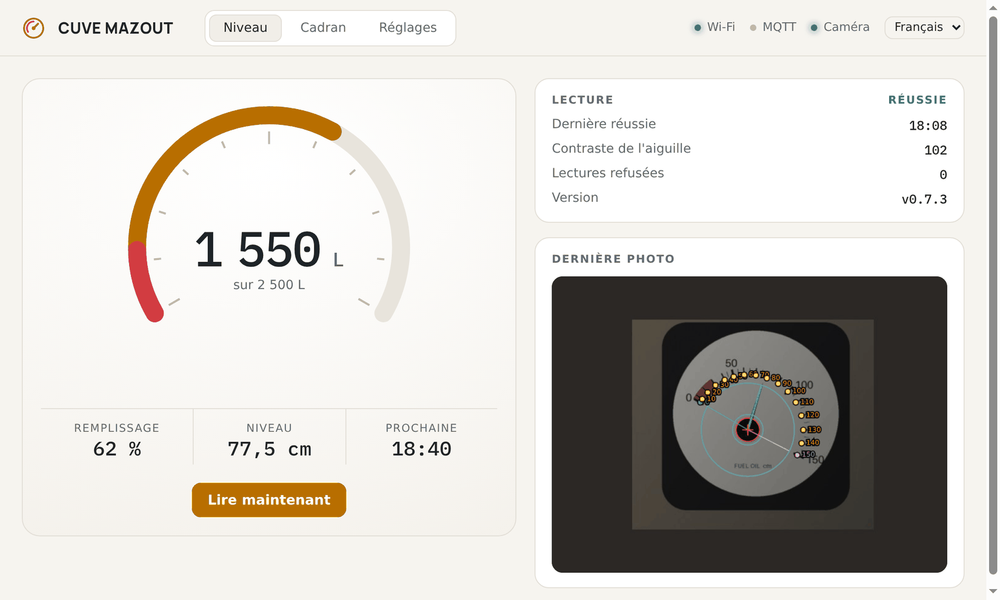
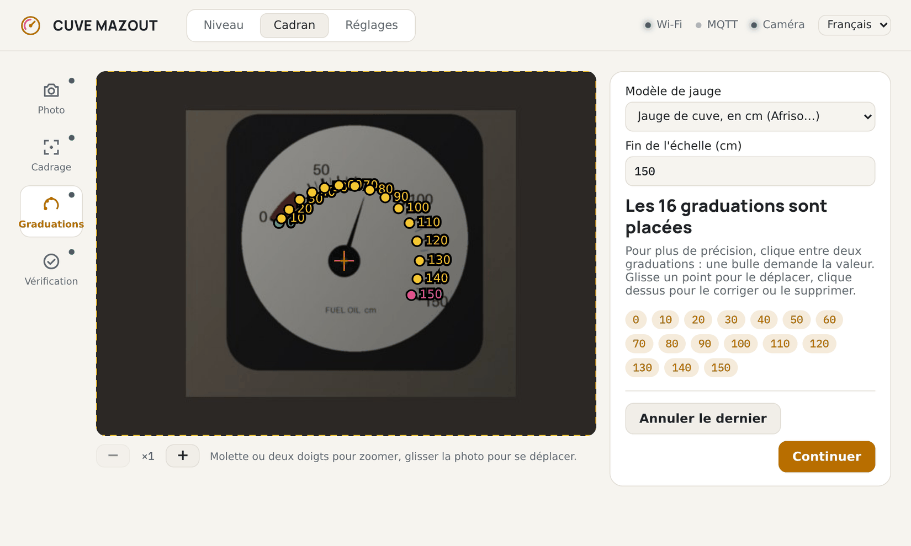

# Gauge Cam

[English](README.md)

Gauge Cam fait d'un ESP32-CAM un lecteur de jauge à aiguille, typiquement l'indicateur de niveau
d'une cuve à mazout. Il envoie le niveau, le volume et le remplissage à Home Assistant.

Tout tourne sur l'appareil : ni cloud, ni modèle d'IA. Tout se règle depuis le navigateur.

**État** : lit un vrai cadran de cuve Afriso toutes les heures depuis novembre 2026.

## Ce qu'il faut

- Un **ESP32-CAM AI-Thinker** et sa carte USB **ESP32-CAM-MB**, environ 10 €.
- Une alimentation **5 V, 1 A** stable.
- Un **serveur MQTT**, par exemple le module Mosquitto de Home Assistant.
- Chrome ou Edge pour flasher l'appareil.

## Démarrer

1. **Flasher.** Ouvre la [page de flash](https://tdebuilt.github.io/gauge-cam/), branche la carte et
   clique sur *Installer*.
2. **Wi-Fi.** Saisis ton réseau quand la page le demande, puis clique sur *Visit device*.
3. **Régler.** Fixe la caméra face au cadran. L'appareil te guide ensuite en six étapes : photo,
   cadrage, graduations, vérification, cuve, Home Assistant.
4. **C'est prêt.** Home Assistant trouve l'appareil tout seul.

Chaque étape en détail : [docs/setup.fr.md](docs/setup.fr.md).

## Fonctions

| | |
|---|---|
| **Lecture** | L'appareil trouve l'aiguille sur la photo. Les échelles irrégulières passent : la valeur est interpolée entre deux points voisins. |
| **Cuve** | Volume d'une cuve parallélépipédique, d'un cylindre couché ou debout, ou de toute forme par une table de jaugeage. |
| **Fiabilité** | Chaque lecture garde la médiane de 3 photos. Un saut brusque doit être confirmé : un reflet est écarté, un remplissage passe. |
| **Home Assistant** | Niveau, volume, remplissage, photo, bouton *Lire maintenant* et mise à jour du firmware, par la découverte MQTT. |
| **Mises à jour** | Installées depuis Home Assistant, même sans Internet sur l'appareil. Le fichier est contrôlé par son empreinte SHA-256, et un firmware qui échoue revient tout seul au précédent. |
| **Sans surveillance** | Chien de garde, relance de la caméra et journal des 80 derniers événements. L'appareil dit aussi pourquoi il a redémarré. |
| **Interface** | En français et en anglais, sur ordinateur ou téléphone. Un mauvais réglage s'annule en un clic. |
| **API** | API HTTP qui se décrit elle-même (OpenAPI), prête pour les scripts et les agents IA. |

## Documentation

| Sujet | Page |
|---|---|
| Matériel, flash et les six étapes de réglage | [Installation](docs/setup.fr.md) |
| Comment une lecture est faite et contrôlée | [Fonctionnement](docs/how-it-works.fr.md) |
| Mises à jour, avec ou sans Internet | [Mises à jour](docs/updates.fr.md) |
| Entités et topics MQTT | [Home Assistant](docs/home-assistant.fr.md) |
| Piloter l'appareil depuis un script | [API HTTP](docs/api.fr.md) |
| Laisser un agent IA lire et régler la jauge | [Agents IA](docs/agents.fr.md) |
| Tests, simulateur, compilation et publication | [Développement](docs/development.fr.md) |
| Ce qui change à chaque version | [Changelog](CHANGELOG.md) (en anglais) |

## Licence

MIT.
