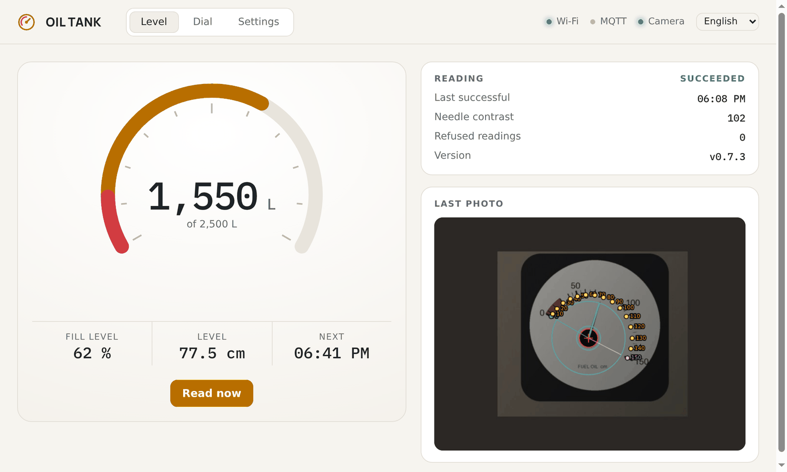
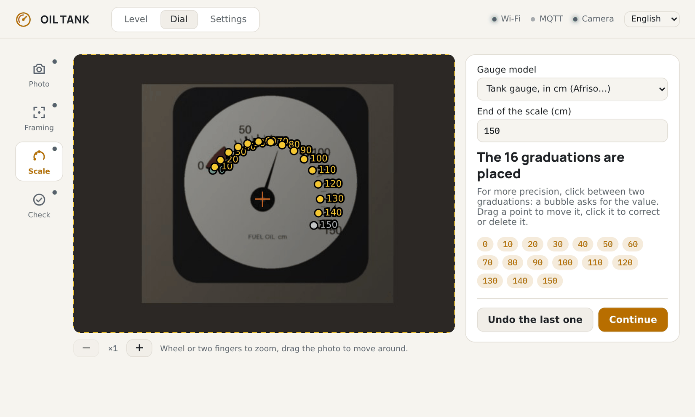

# Gauge Cam

[Français](README.fr.md)

Gauge Cam turns an ESP32-CAM into a reader for a needle gauge, typically the level gauge of a
heating oil tank. It sends the level, the volume and the fill percentage to Home Assistant.

Everything runs on the device: no cloud and no AI model. You set it up from your browser.

**Status**: reading a real Afriso tank gauge every hour since November 2026.

## What you need

- An **AI-Thinker ESP32-CAM** with its **ESP32-CAM-MB** USB board, about €10.
- A steady **5 V, 1 A** power supply.
- An **MQTT broker**, such as the Mosquitto add-on of Home Assistant.
- Chrome or Edge, to flash the device.

## Getting started

1. **Flash.** Open the [flasher page](https://tdebuilt.github.io/gauge-cam/), plug in the board and
   click *Install*.
2. **Wi-Fi.** Enter your network when the page asks, then click *Visit device*.
3. **Set up.** Mount the camera facing the dial. The device then guides you through six steps:
   photo, framing, graduations, check, tank, Home Assistant.
4. **Done.** Home Assistant finds the device on its own.

Each step in detail: [docs/setup.md](docs/setup.md).

## Features

| | |
|---|---|
| **Reading** | The device finds the needle on the photo. Uneven scales work: points are interpolated between their neighbours. |
| **Tank** | Volume for a box tank, a horizontal or upright cylinder, or any shape through a gauging table. |
| **Reliability** | Each reading keeps the median of 3 photos. A sudden jump has to be confirmed, so a reflection is ignored and a refill gets through. |
| **Home Assistant** | Level, volume, fill level, photo, *Read now* button and firmware update, through MQTT discovery. |
| **Updates** | Installed from Home Assistant, even without Internet on the device. The file is checked against its SHA-256 digest, and a firmware that fails rolls back on its own. |
| **Unattended** | A watchdog, camera restarts and a log of the last 80 events. The device also explains why it restarted. |
| **Interface** | In English and French, on a computer or a phone. |

## Documentation

| Topic | Page |
|---|---|
| Hardware, flashing and the six set-up steps | [Setup](docs/setup.md) |
| How a reading is made and checked | [How it works](docs/how-it-works.md) |
| Updates with or without Internet | [Updates](docs/updates.md) |
| Entities and MQTT topics | [Home Assistant](docs/home-assistant.md) |
| Driving the device from a script | [HTTP API](docs/api.md) |
| Tests, simulator, building and releasing | [Development](docs/development.md) |
| What changed in each version | [Changelog](CHANGELOG.md) |

## License

MIT.
